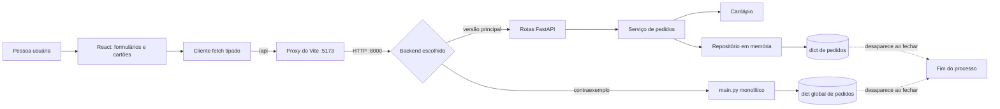
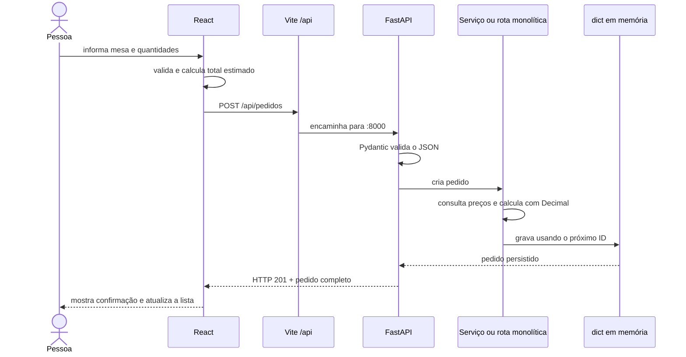
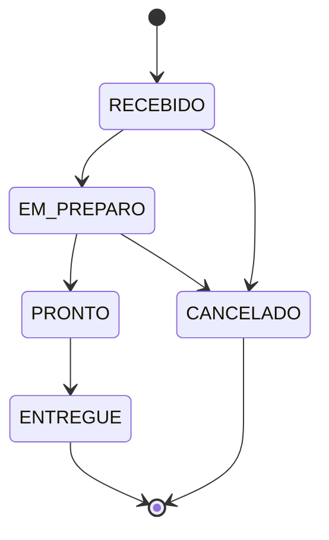

# Guia completo e comentado do projeto

## 1. Visão geral

O projeto é um sistema acadêmico de pedidos para uma lanchonete. A pessoa que
opera a interface pode consultar o cardápio, criar um pedido para uma mesa,
listar e buscar pedidos e atualizar o andamento até a entrega ou o
cancelamento.

Existem três partes principais:

| Parte | Tecnologia | Papel |
| --- | --- | --- |
| `frontend/` | React, TypeScript e Vite | Interface, formulários e comunicação HTTP. |
| `backend/` | FastAPI e Pydantic | API principal com responsabilidades separadas segundo o SRP. |
| `backend_sem_srp/` | FastAPI e Pydantic | Mesma API em um arquivo monolítico, usada como contraexemplo. |

As duas versões do backend possuem o mesmo contrato. O front-end não sabe qual
implementação está ativa: ele chama `/api`, o Vite encaminha a chamada para a
porta `8000` e responde o backend que estiver executando nessa porta.

## 2. Funcionalidades e regras principais

- o cardápio possui seis itens fixos;
- mesa e quantidade devem ser números inteiros positivos;
- o backend controla nomes e preços, evitando valores enviados pelo cliente;
- todo pedido recebe ID sequencial e começa como `RECEBIDO`;
- valores monetários usam `Decimal` no backend e saem como strings com duas
  casas decimais;
- os pedidos existem somente enquanto o processo do servidor está ativo;
- itens repetidos são preservados na ordem de envio;
- atualizações de status obedecem a uma máquina de estados;
- erros de negócio usam HTTP `400` ou `404` e erros de formato usam HTTP `422`.

## 3. Por que o projeto usa `dict`

Um `dict` de Python associa uma chave a um valor. Neste projeto, a chave é o ID
numérico e o valor é o pedido completo:

```text
{
    1: Pedido(...),
    2: Pedido(...),
    3: Pedido(...)
}
```

Essa estrutura foi escolhida porque:

1. a consulta por ID é direta e, em média, tem custo constante;
2. inserir ou substituir um pedido é simples;
3. ela não exige banco de dados para um exemplo acadêmico pequeno;
4. permite demonstrar claramente a responsabilidade de persistência.

O `dict` vive na memória RAM do processo Python. Quando o Uvicorn é fechado ou
reiniciado, o processo termina, a memória é liberada e todos os pedidos
desaparecem. O próximo processo começa com outro `dict` vazio e o contador de
IDs novamente em `1`.

No backend com SRP, o dicionário é privado de
`RepositorioPedidosMemoria`. No backend sem SRP, `_pedidos` é uma variável
global do mesmo `main.py` que contém as rotas. O comportamento externo é igual,
mas a organização e o acoplamento são diferentes.

O front-end também usa estruturas semelhantes:

- `Record<number, number>` relaciona ID do alimento à quantidade digitada;
- `Set<number>` guarda IDs de pedidos que estão sendo atualizados e não admite
  duplicatas;
- arrays mantêm a ordem do cardápio, dos itens e dos pedidos exibidos.

## 4. Conceitos técnicos que merecem atenção

### 4.1 `Decimal` em vez de `float`

Valores de dinheiro não são calculados com `float`, porque números binários de
ponto flutuante podem produzir resultados como `0.1 + 0.2 =
0.30000000000000004`. `Decimal`, construído a partir de texto como `"20.00"`,
mantém a representação decimal adequada. `quantize(Decimal("0.01"))` garante
duas casas decimais.

O `localcontext()` aumenta temporariamente a precisão quando uma quantidade
muito grande é recebida. A mudança fica restrita ao cálculo atual e não altera
globalmente o comportamento de outros pedidos.

### 4.2 `Lock` e requisições simultâneas

Um servidor pode receber duas requisições ao mesmo tempo. Sem proteção, ambas
poderiam ler o mesmo próximo ID antes que o contador fosse incrementado. O
`Lock` cria uma seção crítica: somente uma execução por vez altera o contador e
o dicionário. Isso evita IDs duplicados e atualizações parcialmente aplicadas.

### 4.3 Objetos imutáveis

As entidades do backend com SRP usam `@dataclass(frozen=True, slots=True)`:

- `frozen=True` impede alterações acidentais depois da criação;
- `slots=True` declara previamente os atributos e reduz estruturas internas;
- `dataclasses.replace()` cria uma nova versão do pedido ao mudar seu status.

As coleções do domínio usam tuplas quando a ordem deve ser preservada sem
permitir alteração. `MappingProxyType` oferece uma visão somente leitura do
mapa do cardápio.

### 4.4 Pydantic e contrato estrito

Pydantic converte o JSON recebido em objetos tipados antes de a rota executar.
`Field(strict=True, gt=0)` exige inteiro real e positivo; uma string `"1"` não
é aceita como se fosse número. `ConfigDict(extra="forbid")` rejeita campos que
o contrato não declarou, impedindo o cliente de enviar preço, total ou status
inicial.

`response_model` faz o caminho inverso: define e valida o formato devolvido pela
API e também alimenta a documentação OpenAPI.

### 4.5 Enum de status

`StatusPedido` herda de `str` e `Enum`. O `Enum` limita os valores possíveis; a
herança de `str` faz esses valores serem serializados naturalmente como
`"RECEBIDO"`, `"PRONTO"` e os demais textos do contrato JSON.

### 4.6 Data UTC

`datetime.now(timezone.utc)` cria uma data consciente de fuso. O serializador
converte o valor para ISO 8601 e troca `+00:00` por `Z`, indicador convencional
de UTC. O navegador recebe essa data e a apresenta no fuso local da pessoa.

### 4.7 Estado e efeitos no React

- `useState` guarda valores que alteram o que é renderizado;
- `useEffect` executa o carregamento inicial depois da montagem;
- `AbortController` cancela requisições se a tela for desmontada;
- `useMemo` evita recalcular seleção e total quando as dependências não mudam;
- `useRef` mantém o conjunto de atualizações ativas sem depender da próxima
  renderização;
- atualizações imutáveis criam novos arrays, permitindo que o React perceba a
  mudança.

## 5. Backend com SRP, arquivo por arquivo

### 5.1 `backend/app/models.py`

Contém somente representações do domínio:

- `StatusPedido`: enumera todos os estados válidos;
- `ItemCardapio`: representa um alimento e seu preço;
- `ItemPedido`: registra alimento, quantidade e preço no pedido;
- `Pedido`: reúne ID, mesa, itens, status, total e data.

O ID de `Pedido` aceita `None` antes da persistência. O repositório troca esse
valor pelo próximo número sequencial.

### 5.2 `backend/app/cardapio.py`

| Função ou método | O que procura fazer |
| --- | --- |
| `Cardapio.listar()` | Retorna a tupla completa na ordem oficial. |
| `Cardapio.buscar_por_id()` | Usa o mapa somente leitura para localizar rapidamente um item. |

A tupla é apropriada para listagem ordenada; o mapa é apropriado para busca por
ID. As duas estruturas apontam para os mesmos objetos imutáveis.

### 5.3 `backend/app/repository.py`

| Função ou método | O que procura fazer |
| --- | --- |
| `RepositorioPedidosMemoria.__init__()` | Cria dicionário vazio, contador em `1` e trava. |
| `salvar()` | Gera ID para pedido novo e insere ou substitui o pedido. |
| `listar()` | Lê as chaves ordenadas e devolve uma lista crescente. |
| `buscar_por_id()` | Faz acesso direto à chave e devolve pedido ou `None`. |

O repositório esconde da regra de negócio a decisão de usar memória. Em um
sistema real, outra implementação poderia trocar o `dict` por banco de dados.

### 5.4 `backend/app/service.py`

| Função ou método | O que procura fazer |
| --- | --- |
| Construtores das exceções | Padronizam mensagens dos três erros de negócio. |
| `ServicoPedidos.__init__()` | Recebe repositório e cardápio por injeção. |
| `criar_pedido()` | Valida, consulta preços, monta itens, calcula total e persiste. |
| `listar_pedidos()` | Delega a listagem ao repositório. |
| `buscar_pedido()` | Busca por ID e converte ausência em erro de negócio. |
| `atualizar_status()` | Aceita repetição idempotente ou uma transição permitida. |

O serviço não conhece FastAPI nem códigos HTTP. Essa separação é um ponto
central do SRP: regras de negócio podem ser testadas sem iniciar uma API.

### 5.5 `backend/app/schemas.py`

| Função ou método | O que procura fazer |
| --- | --- |
| `_formatar_valor()` | Produz texto monetário com duas casas. |
| `ItemCardapioResposta.de_dominio()` | Converte alimento interno em resposta HTTP. |
| `PedidoResposta.serializar_criado_em()` | Normaliza a data para UTC terminada em `Z`. |
| `PedidoResposta.de_dominio()` | Converte entidade persistida e seus itens para JSON. |

As demais classes declaram os formatos de entrada e saída. A separação evita
usar diretamente as entidades internas como contrato público.

### 5.6 `backend/app/routes.py`

| Função ou endpoint interno | O que procura fazer |
| --- | --- |
| `criar_router()` | Monta o roteador `/api` usando dependências recebidas. |
| `listar_cardapio()` | Consulta o cardápio e converte os itens para resposta. |
| `criar_pedido()` | Transforma schema em dados do serviço e converte item inválido em HTTP `400`. |
| `listar_pedidos()` | Obtém todos os pedidos e os serializa. |
| `buscar_pedido()` | Consulta um ID e converte ausência em HTTP `404`. |
| `atualizar_status()` | Solicita a regra ao serviço e traduz falhas para HTTP. |

As rotas são `async` porque fazem parte da interface assíncrona do FastAPI,
mesmo que o armazenamento atual em memória não faça entrada e saída externa.

### 5.7 `backend/app/main.py`

`criar_app()` instancia cardápio, repositório e serviço, conecta as dependências
e inclui o roteador. `app = criar_app()` fornece ao Uvicorn o objeto solicitado
por `uvicorn app.main:app`.

Cada nova chamada de `criar_app()` ganha memória própria, propriedade usada
pelos testes para isolar cenários.

## 6. Backend sem SRP

`backend_sem_srp/main.py` reúne os mesmos conceitos em um módulo:

| Função | O que procura fazer |
| --- | --- |
| `PedidoResposta.serializar_criado_em()` | Mantém a data no mesmo formato da API principal. |
| `listar_cardapio()` | Acessa o dicionário do cardápio e formata preços. |
| `criar_pedido()` | Valida IDs, copia dados, calcula, gera ID e grava no dicionário. |
| `listar_pedidos()` | Acessa `_pedidos` diretamente e ordena as chaves. |
| `buscar_pedido()` | Busca diretamente no dicionário e gera HTTP `404`. |
| `atualizar_status()` | Busca, valida transição e substitui o pedido armazenado. |

Essa versão funciona, mas viola deliberadamente o Single Responsibility
Principle. Alterar cardápio, persistência, contrato, regras ou HTTP exige editar
o mesmo arquivo. O problema não é simplesmente o tamanho do arquivo; é a
quantidade de razões independentes para ele mudar.

## 7. Front-end, arquivo por arquivo

### 7.1 `frontend/src/types/api.ts`

Declara o espelho TypeScript do contrato HTTP. A união `StatusPedido` impede o
código de usar um estado inventado. As interfaces descrevem cardápio, criação,
itens persistidos, pedido e atualização.

Essas interfaces não validam JSON em tempo de execução; servem para orientar o
compilador e o desenvolvimento. O backend ainda é a autoridade do contrato.

### 7.2 `frontend/src/api/pedidosApi.ts`

| Função ou classe | O que procura fazer |
| --- | --- |
| `ErroApi` | Carrega mensagem, status HTTP e causa original. |
| `ehRegistro()` | Confirma se um `unknown` pode ser lido como objeto. |
| `formatarLocalizacao()` | Converte localização de validação em texto. |
| `formatarItemDetalhe()` | Extrai mensagem de um detalhe simples ou estruturado. |
| `normalizarDetalhe()` | Une listas de erros em mensagem única. |
| `mensagemPadrao()` | Escolhe texto amigável pelo status HTTP. |
| `obterMensagemErro()` | Interpreta corpo de erro como JSON ou texto. |
| `requisitar<T>()` | Centraliza URL, headers, `fetch`, falhas e leitura do JSON. |
| `listarCardapio()` | Executa `GET /cardapio`. |
| `criarPedido()` | Executa `POST /pedidos`. |
| `listarPedidos()` | Executa `GET /pedidos`. |
| `buscarPedido()` | Executa `GET /pedidos/{id}`. |
| `atualizarStatus()` | Executa `PATCH /pedidos/{id}/status`. |

O parâmetro genérico `<T>` permite que a função compartilhada retorne tipos
diferentes. `AbortSignal` permite cancelar somente as cargas iniciais quando a
tela deixa de existir.

### 7.3 `FormularioPedido.tsx`

| Função ou cálculo | O que procura fazer |
| --- | --- |
| `FormularioPedido()` | Renderiza cardápio, mesa, quantidades, total e envio. |
| `itensSelecionados` | Remove itens com quantidade zero do corpo da API. |
| `totalEstimado` | Calcula apenas a prévia exibida na interface. |
| `alterarQuantidade()` | Aceita inteiro não negativo e atualiza o `Record`. |
| `enviarPedido()` | Valida mesa/itens, chama o componente pai e limpa após sucesso. |

O formulário usa estado controlado: o valor de cada campo vem do React, e cada
alteração chama um atualizador. O total definitivo não é o `totalEstimado`; ele
é recalculado com `Decimal` pelo backend.

### 7.4 `ConsultaPedido.tsx`

`ConsultaPedido()` mantém o texto digitado e uma possível mensagem de erro.
`consultarPedido()` impede o envio HTML padrão, aceita somente inteiro positivo
e entrega o ID ao componente pai.

### 7.5 `CartaoPedido.tsx`

| Função ou estrutura | O que procura fazer |
| --- | --- |
| `ACOES_POR_STATUS` | Mapeia cada status aos botões permitidos. |
| `ROTULOS_STATUS` | Converte valores da API em rótulos de apresentação. |
| `CLASSES_STATUS` | Relaciona estado à classe visual correspondente. |
| `formatarMoeda()` | Converte string decimal em apresentação BRL. |
| `formatarData()` | Converte data ISO para data/hora local. |
| `CartaoPedido()` | Exibe metadados, itens, total, estado e ações. |

O `key` dos itens combina ID e índice porque itens repetidos são permitidos.
`useId()` cria identificadores estáveis para ligar títulos às regiões por ARIA.

### 7.6 `ListaPedidos.tsx`

`ListaPedidos()` escolhe entre carregamento, erro, lista vazia e cartões. Para
cada pedido, consulta `pedidosEmAtualizacao.has(id)` e desabilita somente o
cartão correspondente.

### 7.7 `App.tsx`

| Função | O que procura fazer |
| --- | --- |
| `mensagemDoErro()` | Obtém mensagem segura de uma falha desconhecida. |
| `substituirPedido()` | Atualiza ou insere pedido sem modificar o array anterior. |
| `App()` | Coordena estados e conecta os componentes. |
| `registrarErroInicial()` | Combina falhas das cargas iniciais sem duplicação. |
| `carregarCardapio()` | Busca itens e controla erro/carregamento próprios. |
| `carregarListaPedidos()` | Busca pedidos de forma independente. |
| `criarNovoPedido()` | Chama a API, atualiza lista e produz mensagem. |
| `consultarPedidoPorId()` | Busca um ID e mantém o resultado separado da lista. |
| `atualizarStatusDoPedido()` | Bloqueia duplicidade, atualiza e ressincroniza após erro. |

O `Set` em `atualizacoesAtivas` impede dois PATCH simultâneos para o mesmo
pedido. Ele fica em `useRef` para ser atualizado imediatamente sem aguardar uma
renderização. Uma cópia do conjunto também vai para `useState`, pois essa cópia
é o que faz os botões serem renderizados como desabilitados.

### 7.8 Inicialização e estilos

- `main.tsx` encontra `#root`, inicia o React e ativa `StrictMode` no
  desenvolvimento;
- `index.css` define fonte, cores, box model e comportamento global;
- `App.css` organiza layout, formulários, cartões, estados e responsividade;
- o breakpoint de `800px` transforma duas colunas em uma;
- o breakpoint de `480px` adapta espaços, cartões e botões a celulares;
- atributos ARIA, foco visível e mensagens com `role` tornam os estados mais
  acessíveis.

## 8. Testes

Os nomes dos testes descrevem o comportamento esperado. As suítes estão
separadas em:

- testes unitários do serviço: regras, cálculos e transições sem HTTP;
- testes HTTP da versão com SRP: schemas, códigos, respostas e OpenAPI;
- testes HTTP da versão sem SRP: o mesmo contrato com reinicialização explícita
  das variáveis globais antes de cada caso.

`httpx.ASGITransport` chama a aplicação FastAPI diretamente no processo de
teste. Não é necessário abrir uma porta de rede. A fixture cria ou limpa o
estado para impedir que um teste influencie outro.

## 9. Resumo visual da aplicação

### 9.1 Visão geral



Somente uma das duas ramificações de backend ocupa a porta `8000` por vez.

### 9.2 Criação de um pedido



### 9.3 Ciclo de status



Solicitar o próprio status mantém o pedido como está. Qualquer seta que não
aparece no diagrama representa uma transição proibida e retorna HTTP `400`.

## 10. Síntese final

O ponto mais importante do projeto é a comparação controlada: duas
arquiteturas internas diferentes preservam exatamente a mesma API e atendem o
mesmo front-end.

O backend com SRP favorece manutenção e testes ao separar domínio, cardápio,
persistência, negócio, contratos e HTTP. O backend sem SRP comprova que
funcionar corretamente não significa estar bem organizado: o arquivo único
possui muitas razões para mudar. O `dict` torna o exemplo simples e rápido,
mas é armazenamento temporário; para persistência real seria necessário um
banco de dados ou serviço externo.
